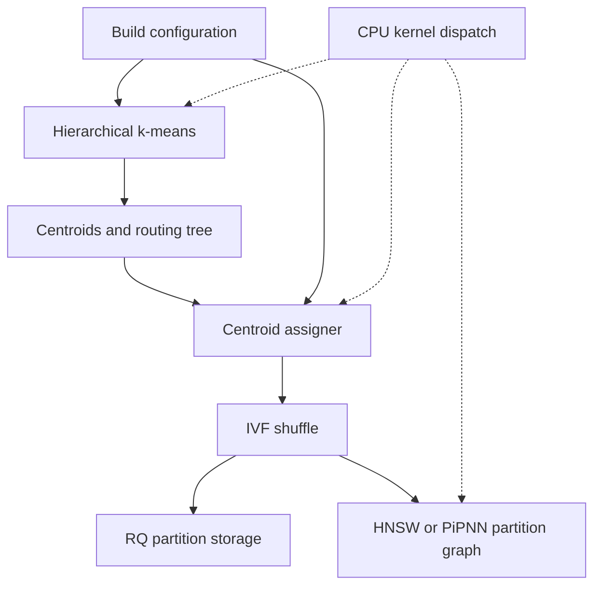
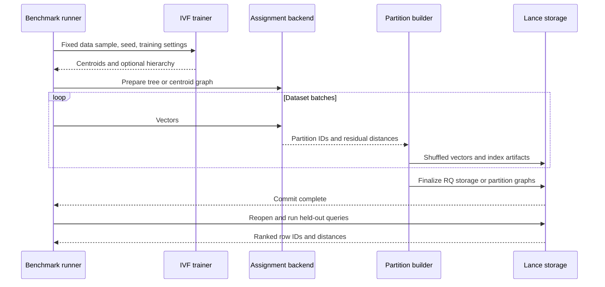

# Lance index build optimization plan

Status: plan defaults accepted on 7 November 2026, with mandatory x86_64 and AArch64 support. Implementation is in progress in `lance_index_build/worktrees/lance` (branch `index-build-tree-pipnn`); see [`lance_index_build/README.md`](lance_index_build/README.md) for per-phase state. Phases 0, 2, 4 and the benchmark runner (phase 1) are done; phase 3 is done for full-dataset assignment; phase 5 builds and searches `IVF_PIPNN_FLAT`; phase 6 has only the ported SVE kernels. x86 smoke tests pass. No full A/B/C measurements or native ARM runs yet.

Prepared 7 November 2026. Primary objective: reduce complete index build time while measuring the effect on query latency, recall, memory, and index size.

## 1. Scope and experiment boundaries

Implement three related capabilities:

1. Retain the hierarchy produced by Lance hierarchical k-means and use it for tree-based centroid assignment.
2. Reuse the fast PiPNN implementation from `claude/loving-clarke-hhboet` in two roles: a temporary index over IVF centroids, and a persisted graph over vectors inside each IVF partition.
3. Extend the existing ARM kernels for the dense routing, leaf-neighbor, and pruning work introduced by these algorithms. Tree assignment and both PiPNN integrations must also work on x86_64, including this development machine.

Both architectures are required deliverables. Implement and benchmark on the current x86_64 host first, then rerun the same frozen experiment configurations on native AArch64 hardware. ARM support must not be deferred until after an x86-only implementation: keep portable paths, architecture-specific code isolation, and ARM correctness checks throughout development.

The benchmark has three suites:

| Suite | Dataset | IVF partitions | Comparison | Main question |
|---|---|---|---|---|
| A: tree assignment | BIGANN10M and GIST1M | Moderate and large counts | Current Lance IVF_RQ versus IVF_RQ with tree assignment | Does retaining the training tree reduce total build time at comparable query quality? |
| B: centroid assignment | BIGANN10M | Strictly above 10,000 | Exact, HNSW, PiPNN, tree assignment; all produce IVF_RQ | Which centroid lookup method gives the best build-time/quality tradeoff? |
| C: partition graphs | BIGANN10M | 4, 5, 6 | IVF_HNSW_FLAT versus proposed IVF_PIPNN_FLAT | Does PiPNN build million-vector partition graphs faster at comparable recall and latency? |

Suite B does **not** replace IVF_RQ's partition search with a graph. Its HNSW/PiPNN graphs contain only centroids and are temporary build accelerators. Suite C stores a graph over dataset vectors in every partition.

Use squared L2 and float32 vectors for the first integrated comparisons. BIGANN's uint8 values convert exactly to float32. Keep a separate uint8 PiPNN/kernel experiment; do not compare uint8 PiPNN against float32 HNSW and attribute the difference solely to graph construction. Quantized partition graphs, approximate query-centroid routing, and online PiPNN mutation are later extensions.

## 2. Verified repository starting point

These observations come from local source inspection; existing performance reports are historical evidence, not measurements of the proposed implementation.

| Area | Observed state | Planning consequence |
|---|---|---|
| Parent repository | `arm-kernels`, commit `619c945`; existing unrelated modified/untracked files | Preserve current work; create isolated implementation checkouts later |
| Lance checkout | `lance-format/`, HEAD `04e61996311dc9907b8b588cad2503a2b8213a08`, with IVF_RQ changes in the working tree | Record the commit **and** patch hash for reproducible builds |
| Existing ARM patch | [`lance_arm_sve/README.md`](lance_arm_sve/README.md), targets `6e18b21e4efaec197208ec212e7b03c3fbecc7d8` | Reconcile revisions before combining changes; its native ARM speedups remain unmeasured |
| Existing IVF_RQ patch | [`lance_ivf_rq/README.md`](lance_ivf_rq/README.md): blocked float32 L2 and optional constant RQ scaling | Hold both settings fixed when comparing assignment algorithms |
| Hierarchical k-means | [`kmeans.rs`](lance-format/rust/lance-index/src/vector/kmeans.rs): enabled for `k > 256` and `hierarchical_k > 1`; defaults are branching 16, zero global refinement iterations | Existing hierarchy is flattened into leaf centroids; routing nodes must be retained explicitly |
| Existing centroid HNSW | [`utils.rs`](lance-format/rust/lance-index/src/vector/utils.rs), `SimpleIndex` | Auto threshold is `K × dimension >= 1,000,000`, with an AMX exception; construction uses 12 edges/ef 15, search ef 15 |
| Full-dataset assignment | [`ivf/transform.rs`](lance-format/rust/lance-index/src/vector/ivf/transform.rs), `PartitionTransformer` | Creates a reusable centroid index and assigns batches; supports distances to caller-supplied partitions |
| IVF training boundary | [`lance/src/index/vector/ivf.rs`](lance-format/rust/lance/src/index/vector/ivf.rs) | Training returns an IVF model with centroids/loss; the retained hierarchy must cross this boundary |
| Fast PiPNN branch | `905bf4b876b9d47a9f0af271d36db340da20eff8`, `native/src/fastpipnn.hpp` on the named branch | C++17/Eigen, L2, float32/uint8, parallel construction, medoid-entry beam search; no Lance storage adapter |
| Current benchmark | [`ivf_rq_gist.rs`](lance-format/rust/lance/benches/ivf_rq_gist.rs) | Has stage timing and recall, but averages a loop that includes recall bookkeeping; replace this with isolated per-query timing |

The PiPNN source implements leader routing, overlapping leaves, local k-NN, HashPrune reservoirs, and RobustPrune. Its optimized paths include AVX-512 comparisons/top-k and a byte-input BF16 Gram kernel. The build files use `-march=native` and `-ffast-math`; these are benchmark choices to audit, not portable Lance package defaults.

The inspected `KMeansParams` already supports seeds, but the normal IVF training call does not pass a seed. Expose and record seed plumbing through the build configuration rather than relying on undocumented randomness.

## 3. Proposed design

### 3.1 Independent configuration axes

Introduce explicit, typed assignment configuration instead of adding mutually exclusive boolean flags. Names below are proposed APIs, not existing commands.

| Axis | Proposed choices | Initial policy |
|---|---|---|
| Local node k-means assignment | Exact | Keep small sibling competitions exact |
| Global refinement assignment | Exact, HNSW, PiPNN, tree | Exact baseline; compare approximate choices separately |
| Full-dataset IVF assignment | Auto, exact, HNSW, PiPNN, tree | Preserve existing auto behavior; benchmark explicit modes |
| IVF partition subindex | Existing flat/RQ or HNSW; new PiPNN | RQ for A/B; flat vector storage with graphs for C |
| Query centroid selection | Existing Lance behavior | Fixed across comparisons |
| CPU implementation | Existing dispatch; additional ARM candidates | Explicitly record which candidates ran |

Use one minimal centroid-assignment interface for batched `(partition_id, squared_distance)` results and lifecycle/telemetry. Its implementation owns a centroid generation and any tree/graph. Construct it once for fixed centroids, share immutable state across batches, and rebuild or refresh it when training moves centroids. Existing public APIs remain callable; add builder options/fallible constructors as needed.

Legacy environment switches remain supported. Define precedence once: explicit configuration wins, otherwise preserve legacy behavior. Record resolved configuration and actual backend, including any fallback. Benchmark explicit modes must error when unavailable rather than silently time another algorithm.



### 3.2 Tree assignment inside hierarchical k-means

Retain contiguous node arrays with child ranges, routing centers, and stable leaf-to-IVF-partition mappings. Preserve the actual size-proportional hierarchy, including merged children and repaired/missing leaves; do not assume a complete balanced tree or that partition IDs equal traversal positions.

Implement two modes:

- **Greedy:** select the nearest child at every level, then evaluate the leaf centroid. This is the low-cost, approximate option.
- **Beam:** expand a bounded set of nodes per depth, retain the best candidates, and evaluate terminal leaf centroids exactly. Carry completed leaves across unequal depths; deduplicate candidates. Expose beam width and report actual distance work.

Distance to an internal routing center is a heuristic, not a lower bound on descendant distance. Do not describe either bounded mode as globally exact. Add an exhaustive traversal test mode that evaluates every leaf as a reference; scalar exact nearest-centroid assignment remains the quality oracle.

Implement in this order:

1. Retain the hierarchy without changing trained centroids, RNG consumption, or partition IDs. Verify parity against the original seeded trainer.
2. Reuse it for full-dataset assignment after training. This isolates the routing change while local k-means remains unchanged.
3. Add optional tree assignment during global refinement. Refresh routing centers after each centroid update; measure refresh cost. Initial policy: retain topology/leaf IDs and recompute internal representatives from descendant centroids and recorded weights. Rebuilding topology is a separate measured alternative if recall degrades.
4. Keep exact local-node assignment and make refinement iterations explicit. Evaluate `refine_iters=0` and a fixed nonzero setting separately; do not hide extra refinement in the tree result.

With balance bias enabled, candidate selection and winner scoring must follow the existing objective. The reported residual distance must exclude the bias. Until this is correctly supported, reject approximate refinement with nonzero balance bias; full-dataset assignment has no such bias. This matters because the inspected IVF training call enables balancing.

For externally supplied centroids without a retained tree, allow an explicitly requested tree over those centroids, charging its build time. Mark it `centroid_built_tree` in results; it is a different construction from `retained_training_tree`.

Initially the tree is build-only state. Preserve existing IVF_RQ query routing and persisted centroid layout. Reconstruct build acceleration state for a later build/append when necessary. Persist a tree only if a later feature actually requires query-time reuse.

### 3.3 PiPNN as the centroid assigner

Build PiPNN over the finalized float32 centroid table. Each incoming vector runs nearest-centroid beam search. Recompute squared L2 to the selected centroid with the standard distance contract before feeding RQ residual encoding. An approximate choice of centroid is allowed; a stale or approximate distance to the chosen centroid is not.

Count graph construction, medoid selection, data packing/copies, and final assignment in total cost. If PiPNN is used during global refinement, rebuild the graph for every updated centroid generation and include all those rebuilds. Reusing a graph with stale vector coordinates is not the initial implementation.

Keep the existing HNSW settings as a named `lance_default_hnsw` baseline. Also tune HNSW and PiPNN search effort independently. Equal ef/beam numbers do not imply equal work or quality.

At small K, exact assignment may win. Preserve a measured exact fallback for auto mode; Suite B forces all requested backends so this crossover remains visible.

### 3.4 PiPNN as an IVF partition subindex

Start with `IVF_PIPNN_FLAT`, paired with existing `IVF_HNSW_FLAT`. Use the same trained centroids, exact full-dataset assignments, vector representation, and partition contents. Only graph construction and graph search differ.

Reuse the existing fast C++ builder behind a narrow optional C ABI, with Rust owning Lance integration and graph search. This retains the optimized implementation instead of first rewriting it. Export adjacency, degrees, entry point, and construction statistics directly in memory; do not invoke the graph-export executable as the production path.

The bridge must catch C++ exceptions, validate sizes/strides, define allocation/free ownership, and keep borrowed vector buffers alive through construction. Avoid duplicating all partition vectors if a contiguous compatible buffer exists. Build the C++ component with explicit Eigen configuration and portable baseline flags; audit dependency/license packaging. Keep a Rust-native builder as a later alternative if the bridge materially limits performance or integration.

Implement Lance's [`IvfSubIndex`](lance-format/rust/lance-index/src/vector/v3/subindex.rs) contract: build, query, serialization/load, empty-partition metadata, remap, and memory accounting. Register a distinct PiPNN subindex/type through the current v3 builder, loader, index inspection, public build parameters, and Python bindings. Do not label a single-layer PiPNN graph as HNSW.

Persist entry point, adjacency/degrees, local vertex-to-row mapping, build parameters, metric, and format identification using the current Lance serialization framework. Check stable-format extensibility before choosing the encoding; introduce a capability/version boundary if required, preserve stable contracts, and do not extend legacy writers. Test reopening in a new process; old unsupported readers must reject clearly where the format contract permits rejection.

For search, use Lance vector storage, row identities, prefilters, and reusable scratch buffers. Traversal may need filtered/deleted vertices for navigation while excluding them from results. Merge candidates across partitions using comparable squared-L2 scores and valid row IDs. Test remapping and deletion behavior; unsupported maintenance operations must return `NotSupported` before mutation rather than silently corrupting graph references.

The source uses locks and joins worker threads. Do not run this construction inside Lance's `spawn_cpu()` closures, whose contract forbids waiting/locks. Use an appropriate bounded blocking execution boundary, keep Eigen internally single-threaded, and coordinate partition concurrency with the builder's thread count. Handle cancellation between construction stages and publish an index only after successful serialization/commit.

### 3.5 Build and query flow



## 4. x86 and ARM support, including new ARM kernels

Tree assignment, PiPNN centroid assignment, and persisted IVF_PIPNN_FLAT must share the same APIs, distance semantics, serialization, and benchmark configuration across x86_64 and AArch64. The C++ builder and Rust integration must compile without x86-only intrinsics leaking into portable code. Keep scalar fallbacks; select AVX2/AVX-512 or NEON/SVE/SVE2 implementations only when available. An ARM machine without SVE must still run every supported algorithm using its available paths.

Architecture is a required result field. Run correctness tests and A/B/C benchmarks on both architectures. Reopen fixtures written on x86 on ARM and vice versa to validate portable graph storage. Frozen dataset hashes, seeds, algorithm parameters, and query IDs are shared across runs; hardware-specific kernel dispatch and resource settings are recorded separately. Do not require bit-identical approximate graphs across floating-point backends; enforce structural correctness and measure numerical/recall differences.

Extend the established runtime dispatcher and numerical contracts. Existing pairwise SVE kernels alone do not provide the data reuse needed for dense routing and leaf matrices.

| Priority | Kernel | Consumers | Verification |
|---|---|---|---|
| P0 | Tiled float32 squared L2 against a small center block, fused argmin/small top-k, optional balance bias | Hierarchical node assignment, tree beam expansion, PiPNN leader routing | Scalar distance/winner reference; ties, NaNs, tails, irregular strides, balance bias |
| P0 | Float32 leaf Gram/L2 tiles with bounded scratch and top-k updates | PiPNN leaf k-NN | Exact small-leaf neighbor reference, both directions, diagonal exclusion, cancellation/error tolerance |
| P1 | Batched candidate L2 and row gathering | RobustPrune and graph search | Existing scalar and SVE distance contracts; noncontiguous IDs and tails |
| P1 | Projection sketches, relative sign comparisons, uint16 hash lookup | PiPNN HashPrune | Same hash/tie semantics and reservoir decisions on controlled inputs |
| P2 | Specialized small-k selection and u8 conversion/integer distance tiles | Leaf k-NN and separately labeled byte-input builds | Overflow bounds, stable tie handling, no unsafe width assumptions |

Start with portable scalar/existing NEON fallbacks and add SVE/SVE2 where the target CPU and OS expose support. Do not assume the server supports SVE, BF16, or SME because it is ARM/Kunpeng. SME is deferred until capability checks and profiles justify it.

Reuse or expose a shared low-level kernel boundary for the Rust tree code and C++ PiPNN builder, avoiding two inconsistent distance implementations. Dispatch outside inner loops. Package architecture-specific objects separately without global `-march=native`; retain the existing variable-length SVE policy and test multiple vector lengths.

Use conservative floating-point compilation first. Treat changed reduction order, Gram-matrix cancellation, BF16 reservoir distances, and any fast-math option as explicit numerical choices. Recheck final nearest candidates/pruning distances where needed. Kernel tests must cover tiny negative Gram-derived squared distances without hiding large numerical errors.

Microbenchmarks include dimensions 128 and 960 plus irregular tails, center counts 4/6/16/32/64, representative routing tiles, and leaf sizes 256/512/1024. Measure packing and end-to-end kernel cost separately. QEMU provides correctness coverage only; native ARM runs determine performance.

## 5. Benchmark protocol

### 5.1 Data, ground truth, and fixed controls

| Dataset | Intended shape | Preparation |
|---|---|---|
| BIGANN10M | First 10,000,000 base vectors, 128 dimensions; 10,000 public queries | Reuse [`prepare_bigann.py`](native/scripts/prepare_bigann.py); validate the exact 10M ground-truth format and IDs |
| GIST1M | 1,000,000 vectors, 960 dimensions; 1,000 queries | Reuse [`convert_gist.py`](lance_ivf_rq/scripts/convert_gist.py); validate metadata and ground truth |

Record source identity, subset rule, hashes, row order, dtype, metric, query IDs, and ground-truth depth. BIGANN's `.ibin` payload includes IDs and distances: validate its layout rather than treating the whole file as IDs. Verify sampled queries by exact search; ground truth for 1B cannot be filtered into valid top-k ground truth for 10M.

Local inventory confirmed on 7 November 2026: `data/bigann10m/` already contains `base.10M.u8bin` (1,280,000,008 bytes; header 10,000,000 × 128), `query.u8bin` (1,280,008 bytes; header 10,000 × 128), `gt.10M.ibin` (8,000,008 bytes; header 10,000 × 100), and `manifest.json` with SHA-256 hashes. Reuse these files; no download is needed. GIST source and converted files also exist in `data/`, with `meta.txt` declaring 1,000,000 × 960 base vectors and 1,000 queries.

All three BIGANN files passed full SHA-256 verification against the existing manifest. Ground-truth validation confirmed the uint32 ID block followed by float32 distances, IDs within the 10M subset, and finite nonnegative distances sorted within each query. This establishes local file integrity and structural validity; sampled exact-neighbor verification remains part of the benchmark preflight.

Deterministically split query IDs into 20% tuning and 80% final evaluation. Use base data only for centroid training. Ground-truth generation, conversion, compilation, and dataset ingestion are outside index-build timing and reported separately. For small smoke-test subsets, recompute exact ground truth on that subset.

Keep training sample IDs, sample rate, iteration limits, branching, refinement count, balancing, RQ rotation/scaling settings, batch sizes, I/O configuration, thread budgets, and seeds fixed within a comparison. Save centroid and partition-assignment checksums. Expose separate seeds for sampling/training, PiPNN, and RQ where randomness exists; record any source that cannot yet be controlled.

RQ5 is the primary A/B configuration. RQ1 and RQ9 are sensitivity runs after validating the primary configuration. Use the standard RQ scaling mode first; the existing constant-scaling optimization is a separately labeled ablation.

### 5.2 Matrix and tuning budget

Avoid an uncontrolled Cartesian product. Run correctness/small-data screening first, tune on held-out tuning queries, then freeze configurations for full evaluation. Use the same predeclared tuning budget per method.

| Suite | Primary matrix | Tuning / sensitivity |
|---|---|---|
| A | GIST1M K={1,000; 16,384}; BIGANN10M K={4,096; 16,384}; current auto, forced exact, greedy tree, beam tree | Tree beam={1,2,4,8,16}; initial branching=16; branching={8,32} on selected cases; refinement={0,2} as separate training conditions |
| B | BIGANN10M K={16,384; 32,768; 65,536}; exact, HNSW, PiPNN, retained tree | Primary full run K=16,384, then scale winners; HNSW ef and PiPNN beam={15,32,64,128}; retain existing HNSW construction baseline and tune construction separately |
| C | BIGANN10M K={4,5,6}; HNSW_FLAT versus PiPNN_FLAT | Start K=5; HNSW m={16,32}, ef_construction={100,200}; PiPNN degree={32,64}, local_k={2,4}, leaf_size={512,1024}; reservoir=160 initially |

PiPNN's branch defaults are the initial reference, not assumed optimal for centroid graphs. Log effective values: for example, `top_leaders=1000` is capped by `max_leaders=512` in the inspected implementation. Tune fanout/reservoir only after profiling membership expansion and memory.

For A/B, sweep query `nprobes={1,4,16,64,256}` initially and extend only if needed to reach quality targets. For C, sweep every `nprobes` from 1 through K and graph search ef/beam={32,64,128,256,512}, constrained to at least requested k. Query `k={10,100}` independently. Do not call the first ten results of a k=100 workload a k=10 latency measurement.

### 5.3 Two layers for assignment experiments

**Fixed-model comparison:** train once for each dataset/K/seed, then give exactly the same centroids to exact, HNSW, PiPNN, and retained-tree assigners. Freeze the hierarchy and centroid IDs. Build IVF_RQ with each set of assignments and otherwise identical settings. This isolates assignment quality and throughput.

**Complete-build comparison:** each method starts from the prepared Lance dataset and runs all required training, hierarchy/index preparation, assignment, encoding, shuffle, and publication. Include tree retention/refresh, graph construction, and copies. Run global refinement variants here as separate conditions. Report total time directly; do not add a shared training time to a cached-model measurement and label it an observed full build.

For C, freeze exact assignments and partition contents for the isolated graph-build comparison, then also time the complete pipeline. Keep assignment acceleration out of the primary graph comparison; combine winning methods only in a final integration run.

### 5.4 Metrics and timing boundaries

| Category | Required measurements |
|---|---|
| Complete build | Wall time from build API start to committed index, vectors/s, CPU time, peak RSS, index bytes, failures/timeouts |
| Training | Sampling, local k-means, refinement, tree retention/refresh, final loss evaluation |
| Assignment | Backend preparation, assignment wall time/throughput, centroid distances evaluated, candidate count, fallback count |
| Shuffle / RQ | Assignment, residual/rotation/encoding, sorting/shuffle, writes, finalization; expose subspans instead of treating shuffle as assignment time |
| PiPNN construction | Sketches, leader partitioning, leaf k-NN, HashPrune/offer work, RobustPrune, medoid, serialization; leaf memberships and graph degrees |
| Assignment quality | Agreement with exact centroid winner, tie-aware nearest-distance agreement, mean/p95/p99 excess squared distance, WCSS, empty partitions and partition size skew |
| Query quality | Recall@10 and Recall@100 against full-dataset ground truth, returned-result count, optional partition coverage of true neighbors |
| Query performance | p50/p95/p99 and mean latency, single-query throughput, separately measured fixed-concurrency QPS, distance evaluations where available |

`Recall@k = mean_q(|unique(returned_k(q)) ∩ truth_k(q)| / k)`. Missing results reduce recall. Keep IDs mapped to the same ground-truth identity space after shuffling and reopening.

Compute exact centroid assignments on a fixed seeded 100,000-vector validation sample for large K, reporting sample size and cost outside timed builds. Report both ID agreement and tie-aware distance agreement. Define relative excess distance using a documented epsilon for zero-distance cases, and also retain absolute excess distances.

Use monotonic per-query timers around request execution and result materialization. Prepare query buffers before timing; compute ground-truth intersections afterward. Measure complete Lance API latency consistently, with optional internal search spans. Label cold-load and warmed-cache runs separately; record the cache reset/prewarm procedure. Reopening alone does not clear OS caches.

Use at least three independent full builds with paired seeds, randomize configuration order, and report individual measurements plus median/range; extend repetitions when variation makes rankings inconclusive. Repeat query passes per build, retain per-query samples, and report confidence intervals with a stated method. Do not pool all latencies into one apparent independent sample across correlated repeats.

Compare at fixed parameters **and** matched recall targets (initially 0.90 and 0.95). Tune nprobes and search effort on tuning queries only. Show build time, p95 latency, memory, and index size on the same quality frontier. If a method cannot reach a target, mark it unattained instead of presenting a lower-quality speedup. Equal degree caps do not imply equal HNSW/PiPNN graph sizes; report actual bytes and effective degree.

### 5.5 Baselines and ARM ablations

Maintain these distinct configurations on a reconciled Lance revision:

1. Unmodified Lance at the pinned revision.
2. Existing IVF_RQ build optimizations with CPU baseline dispatch.
3. The same configuration plus existing ARM kernels.
4. Each new algorithm with the existing kernels.
5. The same algorithm/configuration plus the new ARM kernels.

The primary incremental comparison is against the user's existing optimized configuration; also report the stock baseline. Apply shared distance-kernel improvements to both HNSW and PiPNN where applicable. Hold RQ scaling fixed. Report kernel microbenchmark speedups separately from full-build speedups.

Record CPU model, sockets/NUMA topology, RAM, storage, OS, compiler/toolchain, SVE vector length and detected features, affinity, frequency policy, allocator, thread counts, and all relevant environment variables. Use the repository's `release-with-debug` profile. Compare on the same machine; cross-machine x86/ARM timing is contextual, not an algorithm speedup ratio.

## 6. Memory and concurrency gates

With 4–6 partitions, average partition size is approximately 1.67–2.5M vectors; budget against the largest observed partition. For the branch's padded reservoir size S, degree R, leaf size L, and worker count W, a first-order PiPNN estimate is:

```text
input float32 vectors       = 4 × N × dimension
HashPrune slot arrays       = 8 × N × S
final adjacency             = 4 × N × R
projection sketches         = 4 × N × 16
leaf Gram scratch           ≈ 4 × W × L²
plus headers, degrees, leaf memberships, packed tiles, search scratch,
Lance buffers, allocator overhead, and any serialization/copy overlap
```

At N=2M, dimension=128, S=160, R=64, the first four terms total about 4.22 GB decimal before other costs. Reservoirs and final adjacency overlap during pruning. At 10M across concurrently built partitions, those terms alone total about 21.12 GB. This is a capacity estimate, not measured RSS.

Overlapping PiPNN leaves can multiply memberships; track `leaf_points / N` and peak active routing state. Per-query visited arrays can also scale with partition size and search concurrency. Bound simultaneously active partitions, worker scratch, and C++ threads under a single memory/CPU budget. Fail with a recorded capacity result when the budget is exceeded; do not silently shrink algorithm parameters.

Start Suite C with sequential partition builds and intra-partition parallelism. Test concurrent partitions only after measuring peak RSS. Plan disk capacity for source data, converted Lance data, shuffle spill, and multiple retained index configurations before launching full runs.

## 7. Verification and failure handling

| Area | Required checks before large benchmarks |
|---|---|
| Tree structure | Every centroid appears exactly once as a leaf; valid IDs after merges/repairs; irregular depth, non-power-of-branching K, duplicated vectors |
| Tree routing | Exhaustive traversal matches exact assignment; greedy/beam return valid candidates and exact selected-centroid distances; refinement invalidates/refreshes routing state |
| Numerical kernels | Scalar parity under documented tolerances, ties, null/nonfinite input policy, zero lengths, tails, overflow, multi-width SVE, guard-page tests |
| PiPNN graph | No self/duplicate/out-of-range edges; bounded degree; measured reachability and recall from entry; duplicates terminate; empty/singleton partition adapter behavior |
| FFI | Ownership/lifetime checks, size validation, exception translation, sanitizers, cancellation and partial-build cleanup |
| Lance integration | Multi-fragment builds, reload in a fresh process, row-ID mappings, deleted/filtered rows, remap/compaction or explicit unsupported error, index inspection |
| Regression | Existing IVF_RQ/HNSW builds and queries remain valid; unsupported dtype/metric/configuration rejected before expensive work |
| Harness | Exact-search fixture has recall 1; validates ground-truth layout; latency excludes recall bookkeeping; explicit backend selection verified |

Use small, fast unit fixtures and separate larger recall/performance integration tests. Native Rust/C++ integration and native ARM tests are required in addition to emulated kernel checks. A synthetic PiPNN test does not establish BIGANN10M quality.

The source graph has no proven global connectivity guarantee. Measure entry-point reachability and search recall; if repair is needed, implement and name the repair strategy, include its time/memory, and benchmark it separately from the branch-equivalent baseline.

On build failure or cancellation, clean temporary artifacts and leave existing committed indexes usable. Repeated benchmark runs use unique run/index paths; never reuse partial results as completed builds. Preserve raw failure logs and include failed configurations in reports.

## 8. Implementation sequence and deliverables

| Phase | Work | Exit condition |
|---|---|---|
| 0. Reproducible baseline | Isolated checkout; reconcile patch revisions; pin PiPNN source; x86/ARM toolchain inventory; local data validation; memory estimate | Existing optimized Lance and PiPNN reference tests run; resolved configuration and hashes recorded |
| 1. Benchmark foundation | Generalize GIST runner; BIGANN adapter; seed plumbing; stage spans; per-query timing and raw outputs | Small exact fixtures pass; baseline A/B/C cases reproducible |
| 2. Retained hierarchy | Preserve tree and mappings; greedy/beam batch assignment; selected-distance contract | Fixed-centroid parity checks and tree quality curves on small subsets |
| 3. Tree training integration | Pass hierarchy through IVF training; support explicit refinement policy and balancing contract | Suite A pilot, including total build time and recall on both datasets |
| 4. PiPNN centroid backend | Optional C++ bridge, lifecycle and resource limits, Rust search, assignment adapter | Fixed-centroid comparison against exact/HNSW/tree; Suite B pilot at K=16,384 |
| 5. PiPNN partition graphs | v3 subindex/type, flat storage, serialization/load, filtering, identity mapping and maintenance contract | Small end-to-end reload tests and 1M-scale memory pilot before 10M Suite C |
| 6. ARM kernels and architecture parity | Profile scalar/existing x86/ARM paths; add dense routing/leaf kernels first, then measured bottlenecks | Both architectures compile and pass correctness tests; native microbenchmarks and complete-build ablations |
| 7. Full evaluation | Run A/B/C on x86 first, then rerun frozen configurations on ARM; repetitions and selected sensitivities | Separate x86/ARM raw results and manifests, plots, and final Markdown report |

Dependencies: Phase 1 precedes performance claims; Phase 2 precedes retained-tree comparisons; Phase 4 supplies the PiPNN core used in Phase 5. Profile and optimize only stable, validated paths. Keep each implementation step separately reviewable.

Proposed output layout:

```text
lance_index_build/
  README.md
  configs/                  # versioned A/B/C experiment definitions
  scripts/                  # preparation, orchestration, verification, reporting
  results/<run-id>/
    manifest.json           # revisions, patch/data hashes, machine, resolved options
    builds.jsonl            # wall times, stage spans, RSS, bytes, status
    queries.parquet         # per-query latency, hits, counts, configuration IDs
    assignments.parquet     # sampled exact versus approximate assignment quality
    logs/
    summary.md
    figures/                # recall/latency and build-time/quality plots
```


The final report must include A/B/C separately, full-build and assignment-only timings, matched-recall comparisons, memory/index-size tradeoffs, kernel ablations, failures, and commands/configuration hashes for reproduction. No predicted speedup is a result.

## 9. Accepted defaults and remaining execution prerequisites

The user accepted the defaults above and requires both x86 and ARM support. Do not request confirmation again for these choices. Hardware access and build prerequisites still need to be resolved before the corresponding native runs.

- Target ARM server model, available instruction sets, RAM, storage, and permitted thread budget: discover from the execution host or supplied server access.
- Dataset location: reuse the existing `data/bigann10m/` and GIST files in `data/`; validate checksums/ground truth before timing.
- Primary quality requirement: use recall 0.90/0.95 curves initially; an application-specific recall or latency requirement can replace them before tuning is frozen.
- Resource/time budget: run primary cases first; keep larger-K, RQ-width, branching, and concurrency sweeps explicitly secondary.
- Initial partition graph representation: float32 FLAT for fair HNSW/PiPNN comparison; quantized graph storage is a subsequent, separate experiment.

Current x86 host inventory: AMD EPYC 9124, 32 visible logical CPUs across two NUMA nodes, approximately 125 GiB host RAM; AVX2/AVX-512/BF16 are advertised. Determine effective process/cgroup limits and availability before setting benchmark concurrency. Native ARM host details/access have not yet been provided.

The first build preflight found that Lance's pinned Rust 1.98.1 toolchain is not installed and rustup's download fails certificate verification (`UnknownIssuer`). Resolve the trusted certificate/toolchain setup without disabling TLS verification or silently changing the pinned version. This blocks compiling and testing Lance until resolved.

Completion means working Lance integrations on x86_64 and AArch64 with tests and reproducible native benchmarks on each, followed by evidence showing where each method helps or loses. Dataset validation and the x86 baseline setup are the first implementation-stage work.
