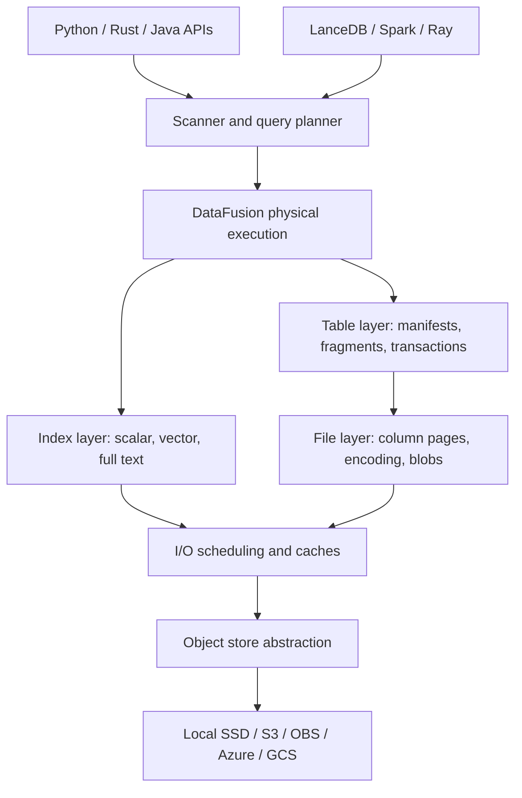
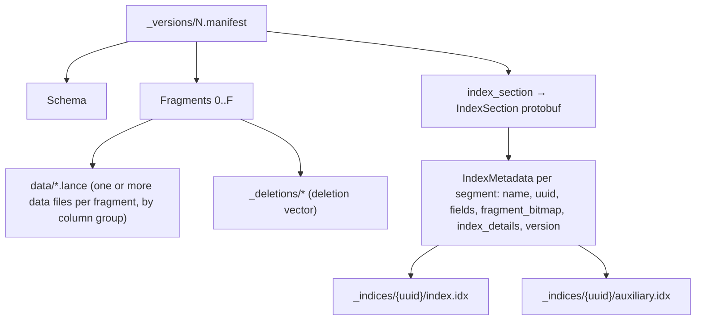
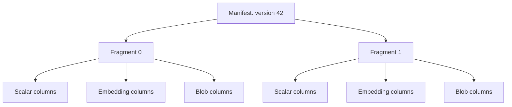
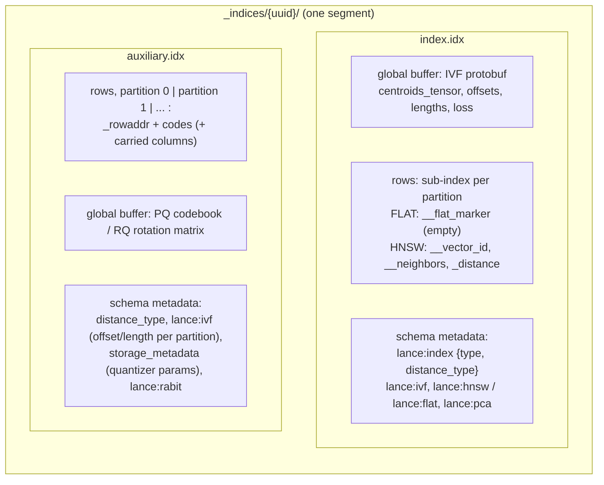
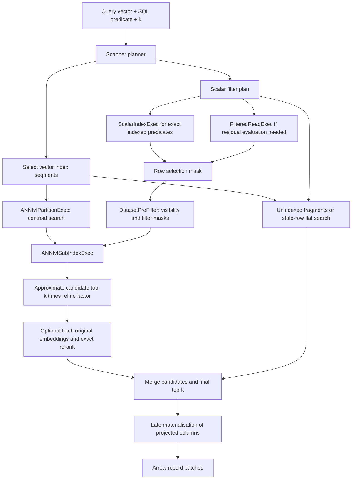
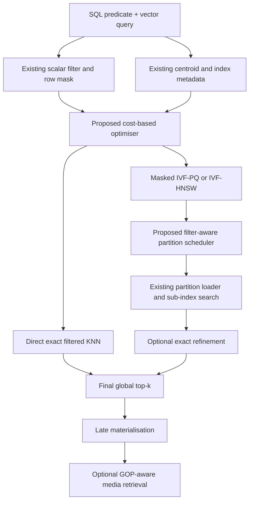
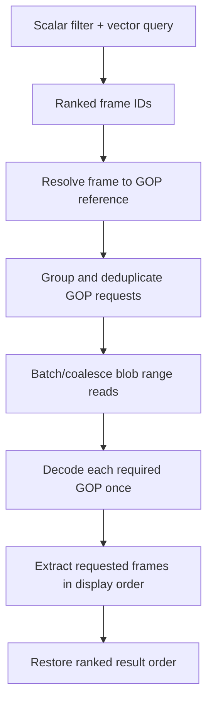

# Lance: Architecture, Filtered Vector Search and GOP-Aware Video Storage

**Technical research notes and proposed engineering design**  
**Date:** 13 November 2026  
**Scope:** Lance core (open-source Rust storage/query engine), scalar + vector filtered ANN, object-storage I/O, and frame-level retrieval from GOP-encoded video.

> **Status and evidence.** This document consolidates the research discussed in the preceding conversation. It distinguishes current Lance design, published research findings and proposed extensions. Source links are provided for verification. Lance's main branch evolves quickly; specific APIs, line numbers and index formats may differ by installed version. Paper performance figures are author-reported, not independently reproduced, and are not measured against Lance unless explicitly stated. The proposed design has not been implemented or benchmarked.

## Contents

1. [Executive summary](#1-executive-summary)
2. [Lance system architecture](#2-lance-system-architecture)
3. [Table, file and blob formats](#3-table-file-and-blob-formats)
4. [Index architecture](#4-index-architecture)
5. [Precise filtered vector-search pipeline](#5-precise-filtered-vector-search-pipeline)
6. [Distributed architecture and IBM lakehouse comparison](#6-distributed-architecture-and-ibm-lakehouse-comparison)
7. [Research literature review](#7-research-literature-review)
8. [Proposed filter-aware Lance design](#8-proposed-filter-aware-lance-design)
9. [GOP-aware video storage and retrieval](#9-gop-aware-video-storage-and-retrieval)
10. [Benchmark and evaluation plan](#10-benchmark-and-evaluation-plan)
11. [Implementation roadmap](#11-implementation-roadmap)
12. [Source-code map and references](#12-source-code-map-and-references)

---

## 1. Executive summary

Lance combines a columnar file format, a versioned table format, native scalar and vector indexes, and an embedded execution engine. It is designed for random access to multimodal datasets on local or remote object storage. It is not, by itself, a multi-node query scheduler; distributed compute can be provided by Spark, Ray or a service layer.

In this document, **hybrid search means structured attribute filtering combined with approximate nearest-neighbour (ANN) search**, not lexical BM25 plus vector fusion. The research literature calls this filtered ANN (FANNS), filtered vector search (FVS), or hybrid ANN.

The key existing Lance mechanism is a row-ID selection mask: scalar indexes produce qualifying row IDs and the vector search operators use the mask to restrict candidate selection. IVF centroid routing and mask construction can overlap. Optional refinement retrieves original vectors for more accurate ranking. Final requested columns are fetched late.

The main opportunities for improved latency are:

- Choose exact filtered KNN versus ANN using a storage-aware cost model.
- Prune vector-index segments and IVF partitions before expensive payload reads, not only before distance calculations.
- Adapt search granularity and partition ordering to the distribution of qualifying vectors.
- Stop searching based on calibrated recall estimates rather than just result count.
- Coalesce and schedule object-store reads, cache useful metadata and minimise unnecessary refinement I/O.
- For video, preserve frame-level logical rows but store independently decodable GOP payloads and decode only after final ranking.

**Target:** at least 2× speedup (a 100% performance increase, equivalent to a 50% latency reduction if measuring a single query) on a clearly defined representative workload, at matched recall and correctness. This is a research target, not an achieved result.

## 2. Lance system architecture

### 2.1 Layered view



| Responsibility | Conventional lakehouse | Lance |
|---|---|---|
| File storage | Parquet | Lance file format |
| Table metadata | Iceberg / Delta Lake | Lance table format |
| Scalar indexing | Separate engine or file statistics | Native scalar indexes |
| Vector indexing | Separate service/library | Native vector indexes |
| Query execution | SQL / distributed engine | Embedded Rust / DataFusion |
| Catalog | External catalog | Lance namespace/catalog integrations |
| Physical storage | Object storage | Local or object storage |
| Multi-node scheduling | Spark, etc. | External execution layer |

OBS in the data-lake context commonly means Huawei Cloud Object Storage Service (analogous to S3). The term is vendor-specific; the underlying storage design is object storage with asynchronous range reads. Actual OBS support depends on compatible endpoint configuration and the Lance object-store implementation.

### 2.2 Dataset organisation and storage layers

A Lance dataset is one directory: a local path or an object-store prefix. A reader reaches every file it needs from a single manifest, so nothing has to be listed except `_versions/` to find the latest version. The layout below follows the storage layout specification (`docs/src/format/table/layout.md`) at the pinned commit (§12.2).

```text
dataset.lance/
├── _versions/
│   ├── *.manifest                 # one immutable manifest per table version
│   └── latest_version_hint.json   # optional hint to the newest version
├── _transactions/
│   └── *.txn                      # transaction records (commit and conflict resolution)
├── data/
│   ├── *.lance                    # data files: column pages for a fragment
│   └── {data_file_stem}/*.blob    # Blob v2 packed / dedicated sidecars
├── _blobs/
│   └── {uuid}.blob                # Blob v2 managed payloads
├── _deletions/
│   └── *.arrow | *.bin            # deletion vectors, one per fragment version
├── _indices/
│   ├── {segment-uuid-1}/          # one directory per index SEGMENT, not per index
│   │   ├── index.idx              # vector index: IVF centroids + sub-index (HNSW graph or FLAT marker)
│   │   └── auxiliary.idx          # vector index: per-partition row addresses + quantized vectors
│   ├── {segment-uuid-2}/          # e.g. a second segment of the same vector index (other fragments)
│   └── {segment-uuid-3}/          # scalar index segment; its own file set (B-tree pages, bitmaps, ...)
├── _refs/{tags,branches}/*.json   # tags and branches
├── _bt/                           # fragment metadata tree objects
└── tree/{branch}/                 # branch datasets
```

The four storage layers and where each lives:

| Layer | What it holds | Location |
|---|---|---|
| Table (manifest) | Schema, version, fragment list (each fragment → its data files and deletion file), index section, base paths | `_versions/*.manifest` |
| File | Column pages, encodings, offsets, footer | `data/*.lance` |
| Blob | Large binary payloads stored out of line | `data/{stem}/*.blob`, `_blobs/`, or external URIs |
| Index | Immutable, self-contained index segments | `_indices/{uuid}/` |

How a reader gets from a version to the bytes:



Key points:

- **The index list is inside the manifest.** The manifest field `index_section` gives the offset of an `IndexSection` protobuf in the manifest file. It holds one `IndexMetadata` entry per segment. Entries with the same `name` form one logical index.
- **Segments cover fragments, not rows.** `fragment_bitmap` records the fragments a segment covers. Segments of one index cover disjoint fragments. Fragments covered by no segment (for example, recent appends) are *unindexed* and are searched by the flat fallback path (§5.3, step 9).
- **Index files are immutable.** A rebuild or `optimize_indices` writes a new `{uuid}` directory and commits a new manifest that points to it. Old directories stay until version cleanup. This makes index files safe to cache.
- **Indexes load on demand.** Opening a dataset reads no index files. A query loads only the parts it needs (§4.3).
- **Files can live under other bases.** Data files, deletion files and index metadata can carry a `base_id` that points into the manifest's `base_paths`, for example a hot bucket and a cold bucket.
- **The vector index does not hold the original vectors** (IVF_FLAT is the exception, storing a full copy). Exact refinement reads them from `data/*.lance` by row address.

## 3. Table, file and blob formats

### 3.1 Table metadata and fragments

A Lance manifest describes the schema, table version, fragments, index references and other snapshot metadata. A fragment represents a horizontal range/set of rows and can have several vertically partitioned data files.



This allows new feature or embedding columns to be added without necessarily rewriting the original multimedia data. Files and manifests are managed using versioned transactions, optimistic concurrency and atomic commit mechanisms appropriate to the storage backend. Appends typically add fragments and publish a new snapshot. Deletions, updates and compaction must preserve index visibility and consistency.

### 3.2 File layout

Unlike Parquet's row-group-centric layout, Lance allows column pages to have independent row boundaries. Small scalars and large embeddings can therefore use different page sizes and encoding strategies. The physical file includes data buffers, metadata, offsets and a footer; actual buffer placement is format-version-specific.

The reader resolves projected columns and requested rows into page/buffer reads. It can issue byte-range requests instead of downloading the entire object. Structural encodings include MiniBlock (small independently decodable groups), FullZip (individually addressable larger values), constant encodings and other version-dependent layouts. Blob handling is a complementary large-payload mechanism.

### 3.3 Row identity

A physical 64-bit row address is conventionally encoded as:

```text
row_address = (fragment_id << 32) | row_offset
```

Physical addresses can change when data is compacted. Lance also supports stable logical row IDs. Search indexes and prefilter masks operate in the appropriate row-ID domain; translation must be handled consistently. From vector index format version 3, each vector-index segment stores the **physical row address** of every vector in `auxiliary.idx` (column `_rowaddr`; IVF_RQ keeps the column name `_rowid`, but it holds addresses). Segments written at version 2 or below store logical row IDs, and segments of the two domains are never merged. For video, an explicit application-level `frame_id` (and potentially stable row IDs) is safer than treating physical addresses as persistent identifiers.

### 3.4 Blob v2

Blob v2 provides an out-of-line large binary representation and lazy access to payloads. Conceptually, its descriptor contains kind, position, size, blob ID and URI information; the exact schema and supported modes are version-dependent.

| Storage mode | Representation |
|---|---|
| Inline | Bytes in the data file |
| Packed | Shared sidecar |
| Dedicated | Individual sidecar |
| External | Reference to an external object |
| Managed | Lance-owned independent object (where supported) |

This architecture is a natural foundation for a GOP-aware video format: retain normal table columns for searchable metadata and keep expensive media payloads out of the query path until needed.

Official specifications: [file](https://lance.org/format/file/), [table](https://lance.org/format/table/), [blob](https://lance.org/format/table/blob/), [blob guide](https://lance.org/guide/blob/).

## 4. Index architecture

### 4.1 Logical indexes and physical segments

A logical index may contain multiple physical segments. Each segment has a UUID and metadata identifying its covered fragments. Appended or updated rows may be uncovered or stale. By default, query execution can search indexed data plus fallback data; fast indexed-only modes can omit uncovered/stale paths.

### 4.2 Scalar indexes

| Index | Common use |
|---|---|
| BTREE | High-cardinality equality, numeric/date ranges |
| BITMAP | Categorical values, low-cardinality fields |
| LABEL_LIST | Multi-valued labels |
| ZONEMAP | Block-level pruning |
| NGRAM | Substring predicates |
| INVERTED (FTS) | Full-text retrieval |
| BLOOMFILTER | Probabilistic block-level equality pruning |
| RTREE | Spatial predicates |
| MINHASHLSH, FM | Near-duplicate detection; FM-index text search |

Exact scalar index expressions can be evaluated using set operations without fetching base rows. Non-exact indexes and unsupported predicates require residual evaluation. SQL NULL semantics matter, especially for NOT and OR.

### 4.3 Vector indexes

Lance composes IVF clustering with a sub-index (flat scan or HNSW) and a vector representation (uncompressed, PQ, SQ, RQ, as supported). Common configurations include IVF_FLAT, IVF_PQ, IVF_SQ, IVF_RQ, IVF_HNSW_FLAT, IVF_HNSW_PQ and IVF_HNSW_SQ. Verify availability in the version being tested.

Conceptually a vector index has three parts: **clustering** (IVF), a **sub-index** inside each partition (FLAT or HNSW) and a **quantization** of the stored vectors (FLAT, PQ, SQ, RQ). The type name is `{clustering}_{sub_index}_{quantization}`, with a FLAT sub-index omitted (IVF_PQ means IVF + FLAT + PQ).

#### Physical layout of one vector-index segment (format V3)

Each segment is two ordinary Lance files in `_indices/{uuid}/`. Both files store all IVF partitions back to back in partition order. `index.idx` answers *where to look*: the centroids and the per-partition search structure. `auxiliary.idx` answers *what to compare*: the row addresses and the quantized vectors.



| | `index.idx` (index file) | `auxiliary.idx` (auxiliary / vector-storage file) |
|---|---|---|
| Role | Search structure | Vector storage |
| Rows | Sub-index per partition. FLAT: a placeholder `__flat_marker` column with no data. HNSW: `__vector_id`, `__neighbors`, `_distance`, levels written from level 0 | One row per indexed vector: `_rowaddr` (u64 physical address; `_rowid` at version ≤ 2) plus codes: `flat` (raw floats), `__pq_code`, `__sq_code`, or `_rabit_codes` plus RQ correction factors. Optional trailing carried (covering) columns |
| Schema metadata | `lance:index` (JSON type and distance), `lance:ivf` (points to the IVF global buffer), `lance:flat` or `lance:hnsw` (per-partition entry point and level offsets), `lance:pca` (experimental, IVF_RQ only) | `distance_type`, `lance:ivf` (offset and length of each partition *in this file*, no centroids), `storage_metadata` (quantizer JSON: PQ `nbits`/`num_sub_vectors`/codebook position; SQ bounds; RQ `num_bits`/`code_dim`/rotation position), `lance:rabit`, `covering_field_ids` |
| Global buffers | IVF protobuf (`centroids_tensor` of `num_partitions × dim`, `offsets`, `lengths`, k-means `loss`); PCA model if present | PQ codebook or RQ rotation matrix (`Tensor`) |
| Size | Small: centroids, plus graphs for HNSW | Large: roughly `n × code size` |

What each file holds per index type:

| Index type | `index.idx` | `auxiliary.idx` |
|---|---|---|
| IVF_FLAT | Centroids + FLAT marker | Raw float vectors |
| IVF_PQ | Centroids + FLAT marker | PQ codes + codebook |
| IVF_SQ | Centroids + FLAT marker | SQ codes + bounds |
| IVF_RQ | Centroids (+ PCA model) + FLAT marker | RabitQ codes, correction factors, rotation matrix |
| IVF_HNSW_{FLAT,PQ,SQ} | Centroids + one HNSW graph per partition | Raw, PQ or SQ codes the graph search scores against |

What a filtered ANN query reads from these files:

1. Read the manifest's index section and pick the segments whose `fragment_bitmap` overlaps the query scope.
2. Read the IVF global buffer from `index.idx` (centroids; kept in the index cache after the first query) and choose the `nprobes` nearest partitions.
3. For each probed partition, look up its offset and length in `auxiliary.idx`'s `lance:ivf` and range-read only that partition's rows (`_rowaddr` + codes). For HNSW, also load that partition's graph rows from `index.idx`.
4. Check each `_rowaddr` against the prefilter mask and score the survivors with the quantized distance.
5. Optional refinement: take the original vectors for the top `k × refine_factor` candidates from `data/*.lance` by row address and rerank exactly.
6. Late materialisation: take the projected columns from `data/*.lance`.

Pruning before step 3 avoids I/O; filtering in step 4 only avoids distance computation. This distinction is the basis for §8.3.

Source: vector index specification (`docs/src/format/index/vector/index.md`), the file names `INDEX_FILE_NAME` / `INDEX_AUXILIARY_FILE_NAME` in `rust/lance-index/src/lib.rs`, the writer in `rust/lance/src/index/vector/builder.rs` (around L1694 and L1885–L1935), and the `IVF` message in `protos/index.proto`.

## 5. Precise filtered vector-search pipeline

### 5.1 Example API

```python
import lance

# query_vector must match the embedding dimension and metric.
ds = lance.dataset("dataset.lance")
scanner = ds.scanner(
    filter="camera_id = 3 AND speed > 20",
    nearest={
        "column": "embedding",
        "q": query_vector,
        "k": 100,
        "nprobes": 20,
        "refine_factor": 2,
    },
    prefilter=True,
    columns=["video_id", "frame_id", "timestamp"],
)
print(scanner.explain_plan(verbose=True))
print(scanner.analyze_plan())
result = scanner.to_table()
```

Use `prefilter=True` explicitly to avoid interface-dependent defaults. `analyze_plan()` executes the query; do not confuse plan inspection with benchmark results. The example assumes compatible indexes and a defined query vector.

### 5.2 Execution flow



The diagram describes a common single-vector indexed prefilter path; specific nodes differ by storage version, index type, filter coverage, batch/multivector search and physical optimizer decisions.

### 5.3 Source-level walkthrough

**1. Filter planning.** [`create_filter_plan()`](https://github.com/lance-format/lance/blob/04e61996311dc9907b8b588cad2503a2b8213a08/rust/lance/src/dataset/scanner/plan.rs#L538) converts the SQL filter into a DataFusion expression, optimises it and chooses usable scalar indexes. The expression filter plan tracks `full_expr`, `index_query` and `refine_expr`.

Example: `camera_id = 3 AND speed > 20 AND temperature < 50`. If camera and speed have suitable indexes, the first two predicates can become an index expression while the temperature predicate must be evaluated on candidate data.

**2. Scalar index evaluation.** [`ScalarIndexExpr::evaluate_with_options()`](https://github.com/lance-format/lance/blob/04e61996311dc9907b8b588cad2503a2b8213a08/rust/lance-index/src/scalar/expression.rs#L2020) evaluates index queries and combines their nullable results. AND/OR branches can run concurrently using `try_join!`.

```text
camera_id = 3 -> {1, 3, 5, 7, 9}
speed > 20    -> {3, 5, 8, 9}
AND           -> {3, 5, 9}
```

**3. Prefilter source.** [`prefilter_source()`](https://github.com/lance-format/lance/blob/04e61996311dc9907b8b588cad2503a2b8213a08/rust/lance/src/dataset/scanner/vector.rs#L1416) selects `None`, `ScalarIndexQuery` or `FilteredRowIds`. Fully covered exact index queries can bypass base data reads. Missing coverage, residual predicates or stale scalar entries may require scanning only necessary filter columns and returning row IDs. Current code can union exact scalar-index results with filtered scans of missing coverage.

**4. Mask construction.** [`build_prefilter()`](https://github.com/lance-format/lance/blob/04e61996311dc9907b8b588cad2503a2b8213a08/rust/lance/src/io/exec/utils.rs#L465) adapts the result into `DatasetPreFilter`. [`wait_for_ready()`](https://github.com/lance-format/lance/blob/04e61996311dc9907b8b588cad2503a2b8213a08/rust/lance/src/index/prefilter.rs#L444) combines filter and visibility constraints. The mask can represent allow lists or block lists, incorporating deleted rows/fragments, stale overlay rows and optional external masks. Prefilter work is asynchronous and may overlap centroid/partition work.

**5. IVF partition selection.** [`new_knn_exec()`](https://github.com/lance-format/lance/blob/04e61996311dc9907b8b588cad2503a2b8213a08/rust/lance/src/io/exec/knn.rs#L1300) constructs `ANNIvfPartitionExec` and `ANNIvfSubIndexExec`. The former finds closest centroids per relevant index segment. The latter applies prefiltering and searches selected partitions. Lance supports minimum/maximum probe counts and additional probing depending on the query and version.

**6. Partition search.** [`search_in_partition()`](https://github.com/lance-format/lance/blob/04e61996311dc9907b8b588cad2503a2b8213a08/rust/lance/src/index/vector/ivf/v2.rs#L2850) loads/searches the partition using the ready prefilter. In the flat sub-index's filtered path, a simplified version of the [actual loop](https://github.com/lance-format/lance/blob/04e61996311dc9907b8b588cad2503a2b8213a08/rust/lance-index/src/vector/flat/index.rs#L181) is:

```rust
// Conceptual pseudocode, not a standalone Rust program.
for (local_id, row_id) in partition.row_ids().enumerate() {
    if !mask.selected(row_id) { continue; }
    let distance = calculator.distance(local_id);
    update_top_k(row_id, distance);
}
```

Other paths can fuse distance, filter and heap operations; HNSW uses graph-specific filtered traversal. Filtering a row does not necessarily avoid I/O for the partition containing it. Current Lance already has partition-level prefilter checks; the research question is how to move these earlier or make them cheaper.

**7. Adaptive probing.** [`late_search()`](https://github.com/lance-format/lance/blob/04e61996311dc9907b8b588cad2503a2b8213a08/rust/lance/src/io/exec/knn.rs#L2197) can search additional partitions if the initial probes do not yield enough candidates. Some implementations have a shortcut for small enumerable masks that emits unseen eligible row IDs with maximum distance for downstream refinement. This should not be confused with a guarantee that all k results are true nearest neighbours.

**8. Exact refinement.** [`vector_search()`](https://github.com/lance-format/lance/blob/04e61996311dc9907b8b588cad2503a2b8213a08/rust/lance/src/dataset/scanner/vector.rs#L132) optionally takes the original embedding column and invokes flat KNN on the approximate candidate set. `k=100, refine_factor=2` targets up to 200 candidates before reranking to 100. Refinement improves ranking of retrieved candidates, but cannot generally recover true neighbours omitted by ANN.

**9. Uncovered or stale data.** [`knn_combined()`](https://github.com/lance-format/lance/blob/04e61996311dc9907b8b588cad2503a2b8213a08/rust/lance/src/dataset/scanner/vector.rs#L796) combines indexed results with filtered exact KNN on missing fragments and targeted stale-row rescoring. `fast_search` can skip fallback paths, trading completeness for speed. Ensure that benchmark comparisons use equivalent visibility and coverage.

**10. Final materialisation.** The scanner applies final filters/order/limit as required and retrieves remaining projected columns after ranking. This is the natural hook for media materialisation.

### 5.4 Prefilter versus postfilter

| Feature | Prefilter | Postfilter |
|---|---|---|
| Candidate universe | Matching live rows | All live rows before filtering |
| Scalar indexes | Can be used | Not used for the ordinary vector postfilter path |
| Result count | Targets k eligible rows | Can return fewer than k |
| Good use case | Selective or correctness-sensitive filters | Broad filters or deliberate approximate oversampling |

A postfilter over global top-k is not equivalent to filtered top-k. Increasing global candidate count can improve the approximation but does not guarantee full filtered recall.

### 5.5 Simplified physical plan

```text
ProjectionExec
  Take / late materialisation
    SortExec: final top 100
      KNNVectorDistanceExec
        Take: original embedding
          SortExec: approximate top 200
            ANNIvfSubIndexExec
              ANNIvfPartitionExec
              ScalarIndexExec
```

This is a reconstruction, not measured `explain_plan()` output. The actual plan may have additional nodes or different operator names.

## 6. Distributed architecture and IBM lakehouse comparison

Lance supports shared remote storage, concurrent access, distributed index construction and external distributed search orchestration. The embedded engine uses asynchronous I/O and multithreading rather than supplying its own distributed query scheduler. Spark/Ray integrations or a service layer can schedule multi-node work.

The IBM lakehouse paper uses Iceberg, Parquet and per-file IVF indexes with distributed compute. Lance stores data in fragments and independent vector-index segments; a segment can span several fragments. Consequently, a data-file predicate may not eliminate a global IVF partition containing a mix of fragments.

| IBM technique | Transfer to embedded Lance |
|---|---|
| Partition/file pruning | Yes, through segment/fragment alignment and metadata |
| Per-file IVF | Approximate analogue: independently built fragment-aligned index segments |
| Physical clustering on attributes | Yes; balance pruning benefit against data layout constraints |
| Worker affinity and rendezvous hashing | Only for distributed deployments |
| Distributed query scheduling | External scheduler required |

The most useful transferable idea is physical alignment of scalar attribute locality and vector-index locality. It can improve single-node remote I/O without replicating IBM's distributed engine. Current Lance already has segment coverage and pruning mechanisms; verify what additional benefit is possible before claiming novelty.

For example, if data is clustered by camera and an index segment covers only camera 2, a query for camera 2 may prune other segments. Segment-level independent training can increase metadata duplication and query fan-out, and complicates merging differently quantized candidate scores.

References: [Lance distributed indexing](https://lance.org/guide/distributed_indexing/), [Spark vector search](https://lance.org/guide/spark/operations/dql/vector-search/), [Ray integration](https://lance.org/integrations/ray/distributed-indexing/).

## 7. Research literature review

The following summaries cover the nine main papers discussed earlier plus two comparative studies. Publication dates and results reflect the earlier research review; check linked versions for revisions. The stated speedups use different baselines, datasets, cache conditions and recall targets, so they must not be compared directly. Some papers are preprints rather than peer-reviewed publications.

### 7.1 Filtered Vector Search in a Disaggregated Lakehouse: Composing Table-Format Pruning with Per-File ANN (IBM Research, 2026)

**Paper:** [arXiv:2608.05441](https://arxiv.org/abs/2608.05441)

**Problem.** A separate global vector index can lose the physical pruning and locality benefits of a lakehouse table. Query-time joins between structured and vector data can be expensive.

**Method.** Embed IVF indexes in individual Parquet files managed by Iceberg. Use table metadata and file statistics to prune files, search local indexes in surviving files, and merge top-k results. In the distributed setting, worker affinity and caching reduce repeated remote reads.

**Reported results.** Approximately 32× speedup over brute force in a warm-index experiment on 11.5 million 768-dimensional vectors with recall@10 at least 90%; approximately 94× versus a query-time join (14.7 s → 157 ms) in a separate experiment on 5 million IBM Granite embeddings, after materialising a region-partitioned layout. A file-pruning experiment skipped 355 of 444 files. These are separate measurements, not one isolated filtering improvement.

**Limitations.** Requires physical attribute locality; scattered predicates may touch nearly all files. Per-file indexes can increase metadata duplication and fan-out. Distributed cache placement does not directly apply to an embedded single-node engine.

**Lance relevance.** Align vector-index segments with physically clustered fragments; prune segments and partitions before loading index data. Compare benefits without assuming distributed execution.

### 7.2 Curator: Efficient Vector Search with Low-Selectivity Filters (SIGMOD 2026)

**Paper:** [arXiv:2601.01291](https://arxiv.org/abs/2601.01291)

**Problem.** Global IVF partitions become sparse when very few vectors satisfy a filter. Searching many mostly irrelevant clusters wastes work and I/O.

**Method.** Construct a shared hierarchical clustering tree. For a given label, sparse regions retain identifiers at higher nodes, while dense regions use finer clusters. Bloom filters guide traversal. The query uses beam and best-first search. For complex predicates, a temporary filter-specific hierarchy can be constructed from a matching identifier set; tree-ordered IDs make subtree membership efficient.

**Reported results.** Up to 20.9× lower latency for low-selectivity queries, measured against the pre-filtering fallback when Curator is integrated with state-of-the-art graph indexes. Approximately 5.5% additional build time and 4.3% additional memory.

**Limitations.** Graph indexes can outperform this method for broad predicates. Maintaining hierarchy and ID locality adds construction/update complexity. Memory-resident evaluation is not automatically representative of remote object storage.

**Lance relevance.** Very strong fit with scalar row masks. An auxiliary mapping from Lance row ID to IVF partition/subcluster/local offset could enable adaptive clustering without changing logical row IDs. Compare a lightweight partition directory before introducing an entire hierarchical index.

### 7.3 FAVOR: Efficient Filter-Agnostic Vector ANNS Based on Selectivity-Aware Exclusion Distances (2026 preprint)

**Paper:** [arXiv:2605.07770](https://arxiv.org/abs/2605.07770)

**Problem.** Hard exclusion in a proximity graph can disconnect paths, while unrestricted graph traversal wastes distance calculations on invalid vectors.

**Method.** Penalise the traversal distance of nodes failing the predicate, while retaining them as potential bridges. Conceptually, use d'(q,v) = d(q,v) + D for excluded vectors, where D is a selectivity-aware penalty. Modify termination logic to avoid stopping too early. Sample predicate selectivity and switch to exact prefiltered search for very restrictive filters (approximately 1% in its evaluated setup).

**Reported results.** The abstract reports 1.3–5× QPS over state-of-the-art methods at recall@10 = 95% for arbitrary filters. The finer split from the earlier review (1.3–5× equality, 1.5–3× inclusion) and the ~1% exact-search threshold are not in the abstract; confirm them in the paper body.

**Limitations.** A fixed percentage threshold is not portable across dataset sizes or storage backends. The penalty model needs calibration for correlated attributes and vector geometry.

**Lance relevance.** Implement storage-aware exact-versus-ANN selection first; investigate the graph penalty only for IVF-HNSW. A 1% mask over 100 million 768-dimensional float32 embeddings still represents about 3.07 GB of uncompressed data, so remote fetch cost matters.

### 7.4 BigFANN: Harmonizing Efficiency and Accuracy in Filtered Vector Search (VLDB 2026)

**Paper:** Zixiang Zhou and Xuhao Chen, PVLDB 19(9), 2026. [PVLDB PDF](https://www.vldb.org/pvldb/vol19/p2059-chen.pdf), DOI [10.14778/3819518.3819534](https://doi.org/10.14778/3819518.3819534) ([author copy](https://chenxuhao.github.io/docs/vldb-2026.pdf))  
**Code:** [zhouzixiang2004/BigFANN](https://github.com/zhouzixiang2004/BigFANN)

**Problem.** Label-specific graphs duplicate edges, while shared graphs can suffer label interference. Multi-label retrieval can waste work if separate vector searches are intersected only afterward.

**Method.** Use shared and label-exclusive graph edges, hybrid IVF/graph structures, and join-free multi-filter search. For a conjunction, search a restrictive label subset and test remaining membership during candidate selection. Very small subsets can use exact scoring.

**Reported results.** The abstract reports up to 786× over UNG and up to 4× over ParlayIVF² at the same or better accuracy. The per-workload figures from the earlier review (3.6× on SIFT100M and 3.1× on YFCC10M single-filter; 786× at 90% and 602× at 95% recall on a double-filter workload) are consistent with that but were not re-verified, nor was the SIFT100M experiment.

**Limitations.** Large speedups depend strongly on baseline weaknesses and query distribution. Label-specific structures increase construction/maintenance complexity.

**Lance relevance.** Lance already intersects scalar masks before ANN; the novel opportunity is selecting a specialised vector index or segment for a common restrictive label and balancing index memory against workload frequency.

### 7.5 VADER: Filtered Vector Search with Declarative Recall (2026 preprint)

**Paper:** [arXiv:2609.38053](https://arxiv.org/abs/2609.38053)

**Problem.** The same global selectivity may imply very different query difficulty depending on local correlation between the filter and query vector. Fixed `nprobes` or `ef_search` can over-search easy queries and under-search hard ones.

**Method.** Train a recall predictor using search-progress features (candidate distances, observed selectivity, search effort and index-specific statistics), penalising optimistic recall estimates. Stop when the predicted recall reaches a requested target. The reported evaluation integrates several graph/IVF search algorithms.

**Reported results.** Up to 53% faster search and up to 28% improved result quality compared with its strongest evaluated baseline.

**Limitations.** Predicted recall is not a deterministic per-query guarantee. Model calibration, drift and the cost of collecting training ground truth matter. Full original text was not retrieved in the earlier review; the summary relied on the abstract and a detailed secondary section-level summary. Verify algorithm details against the paper before implementing.

**Lance relevance.** A natural extension to adaptive IVF probing. Finding k valid candidates is not the same as finding the true nearest k. Collect kth distance, next centroid distance, local selectivity, and searched-partition statistics, then calibrate a stopping rule.

### 7.6 CGIF: Combining Proximity Graphs and Inverted Files for Efficient Filtered Vector Search over Arbitrary Predicates (VLDB 2026)

**Paper:** [DOI:10.14778/3836663.3836716](https://doi.org/10.14778/3836663.3836716)  
**Code:** [rutgers-db/CGIF](https://github.com/rutgers-db/CGIF)

**Problem.** Filtering graph navigation too early can prevent the search from reaching good regions; unrestricted local traversal wastes computation.

**Method.** Use a proximity graph for initial navigation and an IVF index to supply alternative qualifying nodes during local exploration, with two-hop neighbourhood expansion. The code supports query-specific predicate bitsets.

**Reported results.** Up to approximately 2× faster queries at high recall in its evaluated configurations.

**Limitations.** Cross-partition graph jumps could be expensive for remote storage. This summary is based on the published abstract and reference implementation documentation; the complete paper text was not available in the earlier review, and the DOI landing page could not be re-checked (access denied), so the figures above are unverified.

**Lance relevance.** Lance's IVF-HNSW first selects partitions and then navigates local graphs. CGIF reverses the emphasis: graph navigation first, with IVF assistance. It is a more invasive index redesign than modifying the current planner.

### 7.7 PipeANN-Filter: An Efficient Filtered Vector Search System on SSD (2026 preprint)

**Paper:** [arXiv:2605.17992](https://arxiv.org/abs/2605.17992)  
**Code:** [thustorage/PipeANN](https://github.com/thustorage/PipeANN)

**Problem.** Checking metadata predicates can itself cause excessive random SSD I/O when attributes cannot all fit in memory.

**Method.** Maintain probabilistic in-memory attribute summaries (Bloom filters and compact numeric buckets) to admit a superset of valid candidates, followed by exact predicate verification. A cost model selects between prefiltering, inline filtering and postfiltering.

**Reported results versus PipeANN-BaseFilter, at 90% recall** (from the paper body; the abstract gives no numbers, and these were not re-verified):

| Workload | Result |
|---|---|
| YouTube-5M | 1.91× throughput |
| YFCC10M | 1.71× throughput; latency increased about 11% |
| LAION100M single label | 54.5% lower average latency |
| LAION100M range | 9.78× throughput; 87.5% lower latency |

**Limitations.** False-positive candidates still need verification; unsafe pruning would violate filter correctness. SSD I/O and object-store I/O have different latency/concurrency profiles. Higher throughput does not necessarily mean lower individual-query latency.

**Lance relevance.** Cache partition-level metadata and investigate approximate filtering when producing the exact scalar mask is expensive. For an exact scalar-index query, the existing mask may already be cheaper. Any speculative approach must replenish candidates if verification rejects too many.

### 7.8 DYLAN: Dynamic Graph Indexing for Label-Filtered Approximate Nearest Neighbor Search (accepted at SIGMOD 2027; arXiv November 2026)

**Paper:** [arXiv:2611.12539](https://arxiv.org/abs/2611.12539)

**Problem.** Separate indexes for many label combinations are impractical, especially with ongoing updates; a single graph can fragment under filtering.

**Method.** Organise frequency-ordered label sets into a trie, with selectively shared graph structures. Ancestor graph connections bridge regions. Adapt graph construction/rebuilding when region sizes change; use soft deletion. Support containment, overlap and Boolean label queries.

**Reported results.** The abstract states up to two orders of magnitude higher throughput at comparable recall on label-rich datasets. Per-workload figures from the earlier review (not re-verified): on YouTube Audio, 43.5× for containment and 8.7× for overlap at at least 95% recall; some difficult multi-label workloads approach 100× throughput gains. Curator remains competitive on some broad workloads.

**Limitations.** Dynamic graph upkeep must be reconciled with Lance's versioned and fragment-oriented lifecycle. Additional indexing complexity and memory may not be justified for simple range/equality filters.

**Lance relevance.** A potential future specialised index for continuous video ingestion, object-detection labels and scene metadata, rather than the first core IVF optimisation.

### 7.9 ACORN: Performant and Predicate-Agnostic Search Over Vector Embeddings and Structured Data (SIGMOD 2024)

**Paper:** [arXiv:2403.04871](https://arxiv.org/abs/2403.04871)  
**Code:** [stanford-futuredata/ACORN](https://github.com/stanford-futuredata/ACORN)

**Problem.** A filter-induced subgraph may not retain the navigability of the original HNSW graph.

**Method.** Expand neighbourhoods to reach eligible vectors through rejected neighbours. ACORN-γ increases connectivity at construction; ACORN-1 uses more query-time expansion. The predicate-agnostic approach supports arbitrary runtime membership masks, with exact search as a fallback for very restrictive queries.

**Reported results.** The abstract states 2–1,000× higher throughput at fixed recall. Per-dataset figures from the paper body (not re-verified): 2–10× QPS on SIFT1M/Paper, 30–50× on TripClick/LAION1M at 90% recall and about 1,000× in a particular LAION25M configuration. ACORN-γ construction can be up to 11× slower than standard HNSW, with up to 1.3× index footprint; ACORN-1 builds substantially faster than ACORN-γ.

**Limitations.** Higher graph degree or query expansion increases construction, traversal and possibly I/O cost. The largest improvements are workload-specific.

**Lance relevance.** Useful for IVF-HNSW, not a direct improvement to flat IVF-PQ. Inspect the existing filtered HNSW implementation first to avoid duplicating present features.

### 7.10 Comparative studies

- [Attribute Filtering in Approximate Nearest Neighbor Search: An In-depth Experimental Study](https://www.microsoft.com/en-us/research/publication/attribute-filtering-in-approximate-nearest-neighbor-search-an-in-depth-experimental-study/) (2025): comparative study of ten algorithms over selectivities from 0.1% to 100% and datasets up to ten million vectors. Useful for baseline selection.
- [Filtered Approximate Nearest Neighbor Search in Vector Databases: System Design and Performance Analysis](https://arxiv.org/abs/2602.11443) (2026): database-level comparison of FAISS, Milvus and pgvector, emphasising execution strategy and global/local selectivity correlation. Useful for planner design.

### 7.11 Recommended reading priority for embedded Lance

| Priority | Paper | Most transferable contribution |
|---:|---|---|
| 1 | Curator | Adaptive filter-aware IVF hierarchy |
| 2 | VADER | Recall-aware adaptive search effort |
| 3 | FAVOR | Selectivity-aware exact/ANN switching |
| 4 | PipeANN-Filter | Attribute and index I/O cost reduction |
| 5 | IBM Lakehouse | Physical alignment of data and index segments |
| 6 | ACORN / CGIF | Filter-aware HNSW traversal |
| 7 | BigFANN / DYLAN | Specialised multi-label index structures |

This order is an engineering judgement for the embedded Lance target, not a ranking of scientific quality.

## 8. Proposed filter-aware Lance design

**Working title:** I/O-Aware Adaptive Filtered Vector Search for Lance-Based Multimodal Data Lakes.

**Objective:** Reduce p50 and p95 filtered ANN latency at a matched recall target, without replacing the existing storage format or weakening scalar correctness, snapshot consistency or index coverage.

### 8.1 Architecture



The exact branch bypasses ANN scheduling. Any uncovered/stale data must still be searched under equivalent semantics, unless the caller explicitly chooses an indexed-only mode.

### 8.2 Phase A: Instrument and choose exact versus ANN

Gather per-query statistics:

- Filter-mask cardinality (absolute and relative).
- Enumerability of the mask, fragment scope, stable-ID translation cost.
- Vector dimension and storage representation.
- Estimated page/range reads and bytes for fetching matching original vectors.
- Index cache state, partition sizes, I/O latency and concurrency.
- Requested k, recall target and refinement factor.

Estimate the two alternatives:

```text
C_exact = C_mask_iteration + C_vector_fetch + C_exact_distance
C_ann   = C_centroid + C_partition_fetch + C_ann_distance + C_refinement
```

Use measured storage latency and physical locality rather than just selectivity. Overlap and concurrency affect the critical path; these sums are starting points, not a complete wall-clock model. Do not enumerate a broad block-list mask just to count matches. Initially apply the exact branch only to cheap, bounded enumerable masks.

**Implementation:** `scanner/vector.rs`, `DatasetPreFilter`, existing `Take` / flat KNN operators. Start with a simple calibrated cost model and compare to a fixed-cardinality threshold. Preserve metric, deletion semantics, external masks, residual predicates and coverage.

### 8.3 Phase B: Early partition membership pruning

For an exact filter mask M and a partition's row-ID set P_i:

```text
m_i = |M ∩ P_i|
```

If m_i = 0, skip the partition safely. For a conservative approximate membership summary, skip only if it proves the intersection is empty. Nonzero estimated counts must never be treated as exact membership.

Possible representations:

| Representation | Benefit | Cost/risk |
|---|---|---|
| Fragment coverage bitmap per partition | Compact, cheap early pruning | Coarse; many false positives |
| Compressed row-ID set per partition | Exact intersections | Metadata size and read cost |
| Inverse row-ID → partition directory | Efficient for small masks | Maintenance and mapping cost |
| Attribute statistics / Bloom filters | Predicate-specific early pruning | Limited predicate support; false positives |

A plausible experiment uses inverse mapping for small masks and coarse summaries for broad masks. Evaluate metadata size, build time, compaction/update correctness and cache hit rate. Current Lance already has partition-row-ID checks and segment ownership pruning, so instrument those first and demonstrate that additional metadata avoids existing I/O.

Illustrative metadata (proposed, not an existing API):

```rust
struct FilterAwarePartition {
    partition_id: u32,
    num_vectors: u64,
    // Representation selected according to workload and cost.
    row_membership: RowMembershipSummary,
    attribute_stats: AttributeStatistics,
    index_byte_size: u64,
}
```

### 8.4 Phase C: Adaptive partition scheduling and recall

Current IVF centroid ordering gives a geometric prior, while local selectivity provides a predicate prior. For each partition, estimate qualifying cardinality, expected candidate quality and read cost. Schedule partitions by expected retrieval benefit per unit cost.

An illustrative heuristic is `score_i = estimated_matches_i / (centroid_distance_i + epsilon)`, but it is not an established optimal score and may harm recall by prioritising large distant clusters. It should be tested against centroid-only order and exact ground truth. Empty-partition skipping is a correctness-preserving optimisation; reordering/truncating probes is approximate and must be evaluated separately.

Potential progress features:

```rust
struct SearchProgress {
    partitions_searched: usize,
    eligible_candidates: usize,
    observed_selectivity: f32,
    kth_distance: f32,
    next_centroid_distance: f32,
}
```

Train or calibrate an early-stopping rule using exact filtered KNN ground truth. Evaluate recall violations and tail behaviour under out-of-distribution predicates. Preserve a user-controlled search budget and fallback to conservative probing when the predictor is uncertain. A target-recall API would be a new proposal, not an existing Lance guarantee.

### 8.5 Phase D: Object-storage-aware execution

- Cache metadata and membership structures independently of bulky index payloads.
- Schedule scalar filtering and centroid work concurrently where useful.
- Delay partition payload fetch until pruning decisions are ready when the saved I/O outweighs the lost overlap.
- Coalesce adjacent ranges and bound request concurrency and memory.
- Fetch original vectors for refinement in physical order, then restore ranking.
- Separate cold and warm cache measurements; distinguish CPU time, critical-path wall time and aggregate I/O time.

The main principle is to avoid work *before* expensive storage reads, not merely skip vector comparisons after a partition has been loaded.

### 8.6 Correctness and implementation constraints

- Predicate correctness is mandatory; no returned row may violate the SQL filter.
- Match existing snapshot, row-ID domain and deletion visibility rules.
- Handle incomplete scalar/vector indexes and stale overlays.
- Preserve distance metric consistency across exact and approximate candidates and independent index segments.
- Version any persisted index metadata; older readers should safely fall back to existing search.
- Avoid making probabilistic recall predictions into unsupported guarantees.

## 9. GOP-aware video storage and retrieval

### 9.1 Goal

Build a Lance video representation that organises storage at Group of Pictures (GOP) granularity, supports frame-level random access and improves end-to-end retrieval performance by at least 2× on a defined average workload. Reuse existing video codecs rather than design a new compression codec.

A frame-level API does not mean every frame is independently decodable: inter-coded P/B frames depend on preceding or other reference frames. Use independently decodable access units/closed GOPs, include codec initialization metadata, and preserve PTS/DTS ordering. Handle variable frame rates and display-order versus decode-order indexing.

### 9.2 Logical and physical layout

Recommended prototype: separate searchable frame metadata from GOP payloads, linked by stable application-level IDs.

| Frame table field | Purpose |
|---|---|
| frame_id | Stable unique frame identifier |
| video_id | Parent video |
| gop_id | GOP locator within video |
| frame_offset / display_index | Position within GOP |
| pts / timestamp | Display timestamp |
| camera_id / labels / other metadata | Scalar filtering |
| embedding | ANN retrieval |

| GOP table field | Purpose |
|---|---|
| video_id, gop_id | Composite key |
| first_frame, frame_count | Frame coverage |
| start_pts, end_pts | Time coverage |
| codec / stream_init | Decoder configuration |
| frame_index | Display/decode order and packet boundaries as needed |
| payload | Blob v2 encoded GOP |

A two-table prototype avoids duplicating GOP bytes in frame rows. If storing tables independently, define a publication/versioning protocol for consistent references; separate table commits are not automatically one atomic transaction. A native extension could later implement shared GOP references within a single table.

### 9.3 Read path



Example: 100 selected frames from 12 distinct GOPs can potentially share 12 GOP fetches and decode sessions rather than 100 independent operations. This is illustrative, not a measured speedup. Batch processing may fetch extra bytes or decode intermediate frames; balance GOP length, seek latency, compression ratio and reuse.

### 9.4 Existing code and proposals

| Resource | What it provides | Status/limitation |
|---|---|---|
| [lerobot-lancedb](https://github.com/lancedb/lerobot-lancedb) | MP4 byte/keyframe indexing, range fetching and sparse file-like decoding | Verified public reference implementation in earlier review; stores original MP4 intact, not physical GOP-per-blob encoding |
| [reader.py](https://github.com/lancedb/lerobot-lancedb/blob/main/src/lerobot_lancedb/reader.py) | `build_video_byte_index`, `_window_byte_range`, `_fetch_spans`, sparse blob reader | Reference for GOP-aligned range access; check frame-rate assumptions |
| [convert.py](https://github.com/lancedb/lerobot-lancedb/blob/main/src/lerobot_lancedb/convert.py) | Blob v2 video conversion and metadata | Writes original MP4 bytes |
| [Lance PR #7864](https://github.com/lance-format/lance/pull/7864) | Batch blob-range reads | Verified merged in earlier review; reusable for media I/O |
| [LVEE discussion #4320](https://github.com/lance-format/lance/discussions/4320) | Proposed `lvee.blob` and `lvee.gop` representations | Proposal, not verified merged native implementation |
| [Object layer discussion #7174](https://github.com/lance-format/lance/discussions/7174) | Object resolution and range-read/decode planning | Proposal |
| [Blob descriptor discussion #8739](https://github.com/lance-format/lance/discussions/8739) | Nullable `blob_info` in `BlobV2Descriptor` (file version ≥ 2.3) with opaque GOP/frame entries, parsed by `lance-media-runtime` plugins; follows #7174's resolve → plan → read → decode flow | Proposal, not merged. Author reports ~2.86× lower average frame-extraction latency, ~6× less input data and ~17× fewer reads than a `BlobFile` baseline |
| [PR #6587](https://github.com/lance-format/lance/pull/6587), [#6600](https://github.com/lance-format/lance/pull/6600) | Shared blob write deduplication via `ref_id` | Closed without merge in earlier review; public diffs are design references only |

The previously mentioned robotics lakehouse repository could not be verified via GitHub API in the earlier research; it is not relied on as available open-source code here.

The core batch blob-range API observed in the earlier review accepts requests of `(row, offset, length)` with row selector and ordering options. Verify the installed Python/Rust API before implementation. PR #7864 reported 2.47× p50 and 3.64× p95 improvements for its specific S3 range-read workload (64 × 100 KiB ranges, four 500 MiB blobs); this is not an end-to-end video speedup.

### 9.5 Writer/reader plan

1. Ingest MP4 or other supported video; parse packets and access points.
2. Either preserve existing valid closed GOPs or re-encode to create independently decodable GOPs.
3. Persist decoder initialization metadata and frame index (PTS, DTS, frame ordering).
4. Write GOP blobs and searchable frame metadata with consistent identifiers.
5. Support batch frame/clip requests, group by GOP and issue bounded range reads.
6. Decode needed GOPs, extracting all requested frames per session; cache with bounded memory if useful.
7. Validate exact frame identity, timestamps, color/pixel format and seeking correctness against a trusted decoder.

## 10. Benchmark and evaluation plan

### 10.1 Filtered ANN workloads

| Dimension | Test values |
|---|---|
| Dataset size | 1M, 10M, 100M vectors |
| Selectivity (fraction of rows accepted) | 0.01%, 0.1%, 1%, 10%, 50%, 100% |
| Top-k | 10, 100, 1,000 |
| Filter types | Equality, range, label inclusion, AND, OR |
| Filter-vector correlation | Positive, independent, negative |
| Backend | Local SSD, S3/OBS-compatible remote store |
| Cache | Cold, warm; specify which caches cleared |
| Index | IVF-PQ, IVF-HNSW; identical training/metric where possible |
| Recall targets | 90%, 95%, 99% |

Use both public FANNS datasets and a representative multimodal/video workload. Build exact filtered KNN ground truth for each query. Report recall@k against the eligible result set; where fewer than k rows match, use an appropriate denominator and report result completeness separately. Verify no invalid or deleted rows are returned.

### 10.2 Baselines and ablations

1. Unmodified Lance at matched recall (primary baseline).
2. Existing exact filtered KNN.
3. Existing indexed prefilter with tuned probes/refinement.
4. Proposed exact/ANN selector alone.
5. Add early pruning, then adaptive ordering, then early stopping.
6. Optional storage-layout changes and I/O scheduling separately.

Do not compare a tuned prototype with an untuned baseline or an indexed-only fast path against full-snapshot search. Measure index build time, persistent metadata size and memory overhead as well as query performance.

### 10.3 Latency metrics

- End-to-end p50/p95/p99 and throughput at specified concurrency.
- Scalar filter planning/execution and mask construction time.
- Centroid routing and partition selection time.
- Number of candidate partitions, pruned partitions and loaded partitions.
- Number and size of object-store requests, bytes read, cache hits.
- ANN compute, exact refinement and result materialisation time.
- Recall@k distribution, predicate correctness and result completeness.

Use `explain_plan()` and `analyze_plan()` for operator inspection plus explicit benchmark harness measurements. Concurrent stages may overlap, so sum of operator times is not necessarily wall time.

### 10.4 Video-specific workloads

| Workload | Baseline |
|---|---|
| Random single-frame seek | Original video with codec-aware seeking |
| Random short clip | Original MP4/keyframe-range read |
| Batched random frames | Per-frame reads and a strong grouped-range baseline |
| Sequential scan/training | Standard sequential decoding |
| Filter + ANN + media retrieval | Existing Lance search + ordinary media materialisation |

Measure fetch latency, bytes, request count, decoded frames versus requested frames, decoder setup overhead, CPU/GPU utilisation, storage size and compression quality. Include different GOP lengths and frame-selection locality. The best baseline is codec-aware range seeking, not downloading entire videos for every frame.

### 10.5 Success criteria

Define speedup as `baseline_latency / proposed_latency`. A 2× speedup means half the latency. For multiple workloads, predefine a weighting scheme and report a weighted geometric mean of speedup ratios alongside all per-workload results and tail regressions. Averages must not hide poor recall or slow difficult predicates.

Illustrative only: a query reduced from 100 ms to 45 ms has a 2.22× speedup and 55% lower latency. No such Lance result has been measured in this research.

## 11. Implementation roadmap

| Stage | Deliverable | Primary source area |
|---|---|---|
| 1 | Reproducible baseline, trace and latency breakdown | Scanner benchmarks / `analyze_plan` |
| 2 | Runtime exact-vs-ANN cost selector | `dataset/scanner/vector.rs` |
| 3 | Early pruning experiment and metadata design | `index/vector/ivf/`, `index/prefilter.rs` |
| 4 | Filter-aware partition ordering and scheduling | `io/exec/knn.rs` |
| 5 | Calibrated recall-aware stopping | `ANNIvfSubIndexExec` |
| 6 | Range-read scheduling and cache experiments | `lance-io`, file and index readers |
| 7 | GOP writer/reader prototype on Blob v2 | Blob layer + application codec integration |
| 8 | End-to-end video evaluation, compatibility and release | Dataset APIs / tests / benchmarks |

Start with instrumentation and phases 2–3; implement the video prototype independently to separate search improvements from media I/O improvements. Before claiming novelty, compare current Lance main branch (including partition-level prefiltering, adaptive probing, index segments and batch reads) and the literature. Pin a source commit and dependency versions for reproducibility.

## 12. Source-code map and references

### 12.1 Rust crate map

| Crate | Responsibility |
|---|---|
| [lance](https://github.com/lance-format/lance/tree/04e61996311dc9907b8b588cad2503a2b8213a08/rust/lance) | Dataset, scanner, transactions, index orchestration |
| [lance-file](https://github.com/lance-format/lance/tree/04e61996311dc9907b8b588cad2503a2b8213a08/rust/lance-file) | Columnar file reader/writer |
| [lance-encoding](https://github.com/lance-format/lance/tree/04e61996311dc9907b8b588cad2503a2b8213a08/rust/lance-encoding) | Encoders and decoders |
| [lance-table](https://github.com/lance-format/lance/tree/04e61996311dc9907b8b588cad2503a2b8213a08/rust/lance-table) | Table metadata and format |
| [lance-index](https://github.com/lance-format/lance/tree/04e61996311dc9907b8b588cad2503a2b8213a08/rust/lance-index) | Scalar/vector index algorithms |
| [lance-select](https://github.com/lance-format/lance/tree/04e61996311dc9907b8b588cad2503a2b8213a08/rust/lance-select) | Selection masks and row sets |
| [lance-io](https://github.com/lance-format/lance/tree/04e61996311dc9907b8b588cad2503a2b8213a08/rust/lance-io) | I/O scheduling and object stores |
| [lance-linalg](https://github.com/lance-format/lance/tree/04e61996311dc9907b8b588cad2503a2b8213a08/rust/lance-linalg) | Numerical and distance operations |
| [lance-datafusion](https://github.com/lance-format/lance/tree/04e61996311dc9907b8b588cad2503a2b8213a08/rust/lance-datafusion) | Query engine integration |
| [lance-core](https://github.com/lance-format/lance/tree/04e61996311dc9907b8b588cad2503a2b8213a08/rust/lance-core) | Shared types/utilities |

### 12.2 Recommended source reading order

| File | Important entry points |
|---|---|
| [scanner/plan.rs](https://github.com/lance-format/lance/blob/04e61996311dc9907b8b588cad2503a2b8213a08/rust/lance/src/dataset/scanner/plan.rs) | `create_plan_impl`, `create_filter_plan` |
| [scanner/vector.rs](https://github.com/lance-format/lance/blob/04e61996311dc9907b8b588cad2503a2b8213a08/rust/lance/src/dataset/scanner/vector.rs) | `vector_search_source`, `vector_search`, `prefilter_source`, `ann`, `knn_combined`, `flat_knn` |
| [scanner/source.rs](https://github.com/lance-format/lance/blob/04e61996311dc9907b8b588cad2503a2b8213a08/rust/lance/src/dataset/scanner/source.rs) | `filtered_read`, `new_filtered_read`, `take` |
| [scalar/expression.rs](https://github.com/lance-format/lance/blob/04e61996311dc9907b8b588cad2503a2b8213a08/rust/lance-index/src/scalar/expression.rs) | `ScalarIndexExpr::evaluate_with_options` |
| [exec/scalar_index.rs](https://github.com/lance-format/lance/blob/04e61996311dc9907b8b588cad2503a2b8213a08/rust/lance/src/io/exec/scalar_index.rs) | `ScalarIndexExec` |
| [index/prefilter.rs](https://github.com/lance-format/lance/blob/04e61996311dc9907b8b588cad2503a2b8213a08/rust/lance/src/index/prefilter.rs) | `DatasetPreFilter::wait_for_ready`, `filter_row_ids` |
| [exec/utils.rs](https://github.com/lance-format/lance/blob/04e61996311dc9907b8b588cad2503a2b8213a08/rust/lance/src/io/exec/utils.rs) | `build_prefilter`, `SelectionVectorToPrefilter`, `FilteredRowIdsToPrefilter` |
| [exec/knn.rs](https://github.com/lance-format/lance/blob/04e61996311dc9907b8b588cad2503a2b8213a08/rust/lance/src/io/exec/knn.rs) | `ANNIvfPartitionExec`, `ANNIvfSubIndexExec`, `initial_search`, `late_search`, `KNNVectorDistanceExec` |
| [ivf/v2.rs](https://github.com/lance-format/lance/blob/04e61996311dc9907b8b588cad2503a2b8213a08/rust/lance/src/index/vector/ivf/v2.rs) | `search_in_partition`, `prefilter_for_partition` |
| [flat/index.rs](https://github.com/lance-format/lance/blob/04e61996311dc9907b8b588cad2503a2b8213a08/rust/lance-index/src/vector/flat/index.rs) | `search_with_scratch` and masked scoring |
| [hnsw/builder.rs](https://github.com/lance-format/lance/blob/04e61996311dc9907b8b588cad2503a2b8213a08/rust/lance-index/src/vector/hnsw/builder.rs) | Graph search and prefilter integration |
| [dataset/blob/](https://github.com/lance-format/lance/tree/04e61996311dc9907b8b588cad2503a2b8213a08/rust/lance/src/dataset/blob) and [blob.rs](https://github.com/lance-format/lance/blob/04e61996311dc9907b8b588cad2503a2b8213a08/rust/lance/src/blob.rs) | Blob read/locate/write and batch range reads; `BlobKind` dispatch |
| [lance-index/src/lib.rs](https://github.com/lance-format/lance/blob/04e61996311dc9907b8b588cad2503a2b8213a08/rust/lance-index/src/lib.rs#L33) | `INDEX_FILE_NAME` (`index.idx`), `INDEX_AUXILIARY_FILE_NAME` (`auxiliary.idx`) |
| [index/vector/builder.rs](https://github.com/lance-format/lance/blob/04e61996311dc9907b8b588cad2503a2b8213a08/rust/lance/src/index/vector/builder.rs#L1694) | Writes both vector-index files and their schema metadata |

All source links are pinned to commit `04e61996311dc9907b8b588cad2503a2b8213a08` (upstream `main`, 5 November 2026). Function names and line numbers were re-checked against that commit on 13 November 2026.

### 12.3 Official documentation

- [Lance repository](https://github.com/lance-format/lance)
- [Format architecture](https://lance.org/format/)
- [File format](https://lance.org/format/file/)
- [File encoding](https://lance.org/format/file/encoding/)
- [Table format](https://lance.org/format/table/)
- [Transactions](https://lance.org/format/table/transaction/)
- [Index specification](https://lance.org/format/index/)
- [Vector index specification](https://lance.org/format/index/vector/)
- [Blob specification](https://lance.org/format/table/blob/)
- [Blob guide](https://lance.org/guide/blob/)
- [Distributed indexing](https://lance.org/guide/distributed_indexing/)
- [Spark vector search](https://lance.org/guide/spark/operations/dql/vector-search/)

### 12.4 Open-source research implementations and benchmarks

- [FANNBench](https://github.com/lmccccc/FANNBench)
- [ACORN](https://github.com/stanford-futuredata/ACORN)
- [BigFANN](https://github.com/zhouzixiang2004/BigFANN)
- [CGIF](https://github.com/rutgers-db/CGIF)
- [PipeANN](https://github.com/thustorage/PipeANN)
- [LeRobot-LanceDB](https://github.com/lancedb/lerobot-lancedb)

## Conclusion

Lance's key advantage is the ability to co-design physical storage, scalar predicates, vector index execution and late random access. For embedded Lance, the most promising initial research path is storage-aware exact-versus-ANN selection, followed by earlier partition pruning and calibrated adaptive probing. A distributed scheduler is not a prerequisite for these improvements. GOP-aware media materialisation is a complementary extension that can turn ranked frame IDs into efficient video reads without modifying the search algorithm itself.

The engineering roadmap and all proposed optimisations remain hypotheses until implemented, measured at matched recall and validated against the current Lance source. This export consolidates earlier research rather than re-verifying every paper, URL, benchmark or API against a new checkout.
